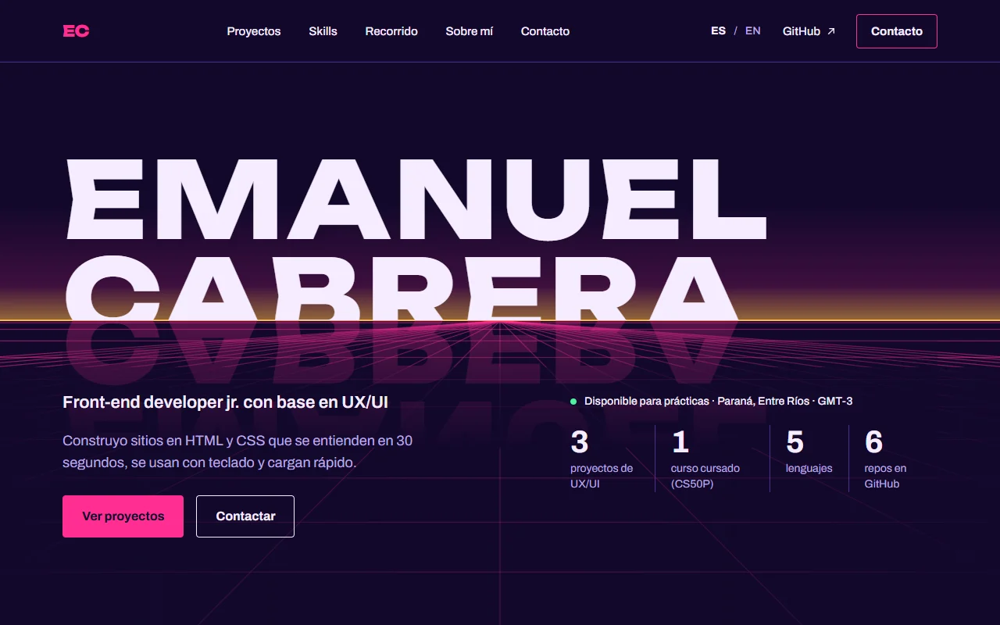
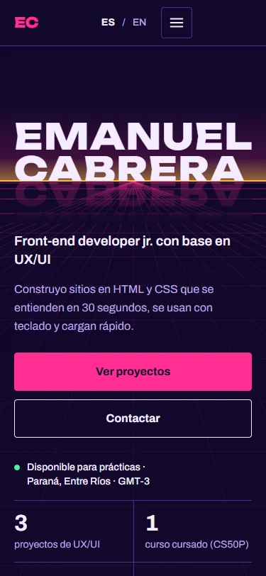
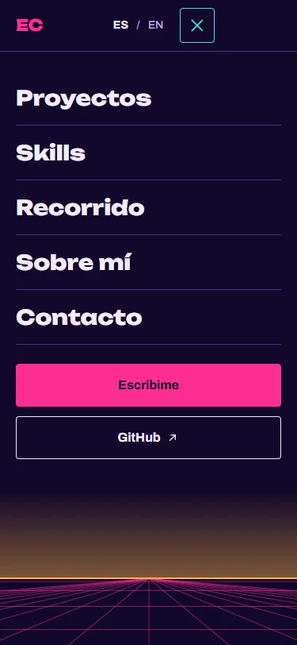
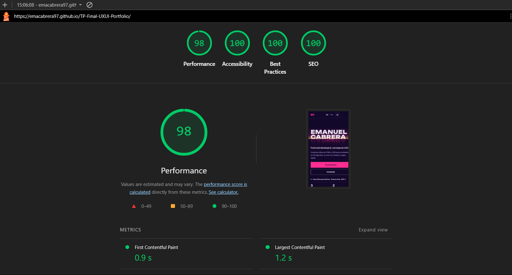
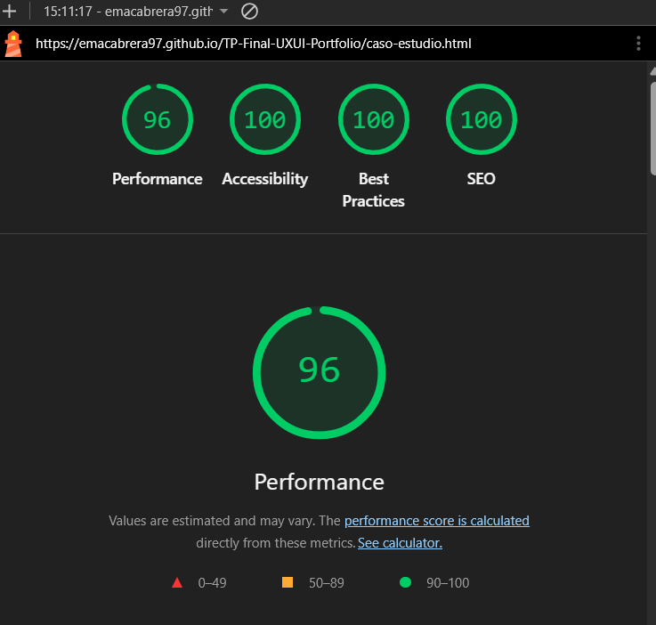

# Portfolio Web · Emanuel Cabrera

Portfolio personal one-page de **Emanuel Cabrera**, front-end developer jr. con base en UX/UI. Es el trabajo final de **Diseño UX-UI 2026**, Licenciatura en Sistemas de Información, FCyT (Sede Concepción del Uruguay), docente: Mg. Ernesto Ledesma.

| | |
|---|---|
| 🌐 **Sitio publicado** | https://emacabrera97.github.io/TP-Final-UXUI-Portfolio/ |
| 🎨 **Figma** (design system, desktop, mobile, caso de estudio y prototipo) | [Portfolio Web · Synthwave](https://www.figma.com/design/xDbdNZ00ZAdd3r0RkGvOVZ/Portfolio-Web---Synthwave--TP-Final-UX-UI-?node-id=22-1504) |
| 📁 **Repositorio** | https://github.com/emacabrera97/TP-Final-UXUI-Portfolio |



<p>
  
  
</p>

---

## Concepto visual

**"El nombre es el horizonte."** El nombre funciona como horizonte de una escena synthwave: la segunda línea queda cortada por una línea ámbar y su reflejo magenta se hunde en una grilla en perspectiva. El mismo horizonte vuelve como cierre en Contacto y en el menú mobile, así la página tiene un principio y un final.

| Rol | Token | Uso |
|---|---|---|
| Fondo | `--bg-base` `#12082B` | Página (índigo noche) |
| Acento dominante | `--magenta` `#FF2E93` | Grilla, CTA, subrayados (5.5:1) |
| Foco y hover | `--cyan` `#2DE2E6` | Solo estados interactivos (12:1) |
| Luz | `--amber` `#FFB547` | Solo el horizonte y el estado *active* |
| Texto | `--text` `#F5ECFF` / `--text-muted` `#BBA9E0` | 16.7:1 / 9:1 |

Tipografías (2 familias): **Unbounded ExtraBold** para el nombre, los títulos de sección y el menú; **Archivo** para todo lo demás. Radio de 4 px, filetes de 1 px, espaciado en múltiplos de 4 y 8 y grilla de 12 columnas con márgenes de 80 en desktop (4 columnas con márgenes de 20 en mobile).

## Arquitectura de información

One-page con navegación por anclas. Las 9 secciones de la consigna están presentes:

1. **Header** fijo: iniciales, anclas, selector ES/EN, GitHub y CTA de contacto (menú hamburguesa en mobile).
2. **Hero** (`#inicio`): nombre, rol, propuesta de valor, 2 CTAs, disponibilidad y ubicación con zona horaria.
3. **Métricas** (`#metricas`): 4 cifras como lectura sobre el horizonte, dentro del hero.
4. **Proyectos** (`#projects`): 3 proyectos; el destacado tiene [caso de estudio propio](caso-estudio.html).
5. **Skills** (`#skills`): 4 categorías con descripción y herramientas.
6. **Recorrido** (`#experience`): timeline con período, rol, institución y 2 logros.
7. **Sobre mí** (`#about`): presentación, ilustración con texto alternativo y 3 principios.
8. **Contacto** (`#contact`): CTA, `mailto:`, LinkedIn y GitHub.
9. **Footer**: copyright con año, navegación repetida, redes y crédito de tecnología.

**Cambios de orden justificados:**
- *Proyectos antes que Skills.* Para el usuario objetivo (reclutador o estudio que decide en menos de 30 segundos), la prueba de trabajo pesa más que la lista de herramientas.
- *Métricas dentro del hero.* Se leen como un tablero sobre el horizonte, sin agregar una fila más de tarjetas iguales, y quedan visibles en el primer pantallazo.

Páginas extra: `caso-estudio.html` (problema → proceso → solución → resultado → aprendizajes) y `404.html` personalizada.

## Stack

- **HTML5 semántico**: `header`, `nav`, `main`, `section` con `id`, `article`, `footer`. Un solo `h1` por página y `h2`/`h3` sin saltos.
- **CSS3 puro** con variables en `:root` (`css/tokens.css`), Flexbox y Grid, mobile-first.
- **JavaScript vanilla** (opcional según la consigna): menú mobile accesible, link activo, año del footer y selector de idioma.
- Sin frameworks, sin constructores visuales, **sin templates de base**. El diseño es propio y se hizo en Figma.

```
index.html            one-page
caso-estudio.html     caso de estudio desarrollado
404.html              página 404 personalizada
css/tokens.css        design tokens (paleta, tipografía, espaciado, grilla) + @font-face
css/base.css          reset, foco visible, skip link, scroll suave, reduced motion
css/components.css    botón, links, selector de idioma, tags, filas, métrica, disponibilidad
css/layout.css        header y menú mobile
css/sections.css      hero, proyectos, skills, recorrido, sobre mí, contacto, footer
css/case.css          página de caso de estudio
js/main.js            menú mobile, link activo, año
js/i18n.js            ES / EN
assets/               fuentes woff2, íconos SVG, imágenes WebP y SVG exportadas de Figma
.github/workflows/    deploy a GitHub Pages
```

## Accesibilidad (WCAG 2.2 AA) y responsive

- Contraste medido sobre el fondo: el texto más bajo es 5.5:1.
- Navegable 100% con teclado, foco visible cian de 3 px y link **"Saltar al contenido"**.
- `lang` en `<html>`, que cambia con el selector de idioma. El menú mobile usa `aria-expanded` y `aria-controls`, se cierra con Esc, atrapa el foco y bloquea el scroll del fondo.
- Las imágenes tienen `alt` descriptivo; las decorativas usan `alt=""` o `aria-hidden`. Los links externos llevan `target="_blank" rel="noopener noreferrer"` y un aviso para lectores de pantalla.
- `scroll-behavior: smooth` + `scroll-margin-top` para que el header fijo no tape los títulos.
- Todos los elementos interactivos tienen estados `:hover` (cian), `:focus-visible` y `:active` (ámbar).
- `prefers-reduced-motion` desactiva transiciones, el scroll suave y el movimiento de las tarjetas.
- Breakpoints probados en **375, 768 y 1280 px** sin scroll horizontal (cambios de layout en 768, 1024 y 1280).
- **Microinteracción**: al pasar el mouse o hacer foco en un proyecto, el mockup se eleva, la grilla se ilumina y el borde pasa a magenta.

## Performance y SEO

- Fuentes self-hosted (subset latino), `font-display: swap` y `preload`.
- Imágenes en **WebP** 1x/2x con `srcset`, `width`/`height` y `loading="lazy"` debajo del pliegue.
- Metadatos completos: `title`, `meta description`, Open Graph (`og:title`, `og:description`, `og:image`), `theme-color`, favicon, `viewport` y `canonical`.

**Lighthouse mobile** sobre la URL pública (09/11/2026):

| Página | Performance | Accessibility | Best Practices | SEO |
|---|---|---|---|---|
| [Inicio](docs/lighthouse-mobile.png) | 98 | 100 | 100 | 100 |
| [Caso de estudio](docs/lighthouse-mobile-caso.png) | 96 | 100 | 100 | 100 |





## Deploy (GitHub Pages con GitHub Actions)

El sitio se publica automáticamente en cada push a `main` con [`.github/workflows/deploy.yml`](.github/workflows/deploy.yml). No hace falta build: el workflow copia los archivos del sitio y los publica.

Pasos para configurarlo (una sola vez):
1. Subir el repo a GitHub: `git push origin main`.
2. En el repo: **Settings → Pages → Build and deployment → Source: GitHub Actions**.
3. Esperar a que termine la acción "Deploy a GitHub Pages" en la pestaña **Actions**.
4. Agregar la URL en la descripción del repo (⚙️ junto a *About*).

Para probarlo en local, cualquier servidor estático alcanza, por ejemplo `npx serve .` o `python -m http.server`. La 404 usa rutas absolutas `/TP-Final-UXUI-Portfolio/…` porque GitHub Pages la sirve en cualquier ruta inexistente.

## Contenido a completar

Siguiendo la consigna (contenido real, o ficticio pero verosímil), estos datos todavía son ilustrativos y están marcados en el código con `[placeholder]`:
- Foto real para *Sobre mí* (por ahora hay una ilustración).
- Link de Figma del sistema de diseño y demo de la landing.
- Institución del curso y organización del voluntariado.
- Resultados del test del caso de estudio (38% → 91%, etc.).

## Créditos y recursos

- Diseño propio en Figma (sin template de base).
- Tipografías: [Unbounded](https://fonts.google.com/specimen/Unbounded) y [Archivo](https://fonts.google.com/specimen/Archivo) (Google Fonts, licencia SIL Open Font License), servidas desde el repo.
- Íconos, grillas, sol y mockups: exportados del archivo de Figma (mockups ilustrativos, rotulados como tales).
- Herramientas: Figma, Lighthouse y sharp (conversión a WebP).

## Uso de IA

Usé **Claude (Anthropic) en Claude Code** como asistente de implementación. Con el diseño de Figma como referencia, generó el HTML/CSS/JS, exportó y optimizó los assets (WebP, fuentes), escribió el diccionario en inglés, el workflow de deploy y este README. Las decisiones de diseño (concepto, paleta, tipografía, layout, contenido y orden de secciones) vienen del archivo de Figma. Revisé el resultado así:
- Capturas automáticas a 375, 768 y 1280 px comparadas con los frames de Figma.
- Recorrido completo con teclado y verificación del foco visible.
- Lighthouse mobile en las dos páginas.
- Lectura del código y de los textos antes de cada commit.
